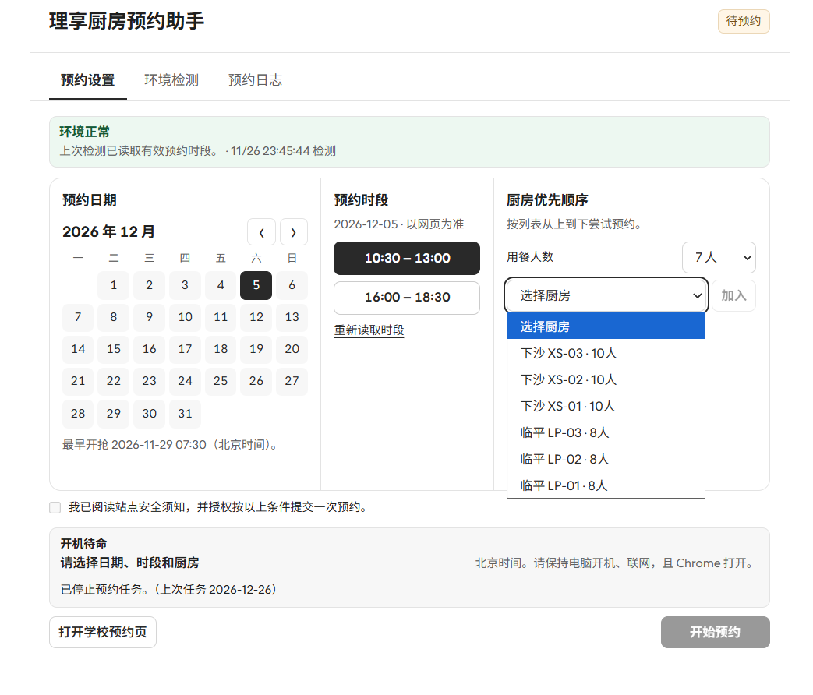
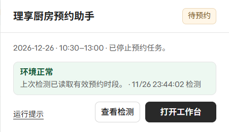
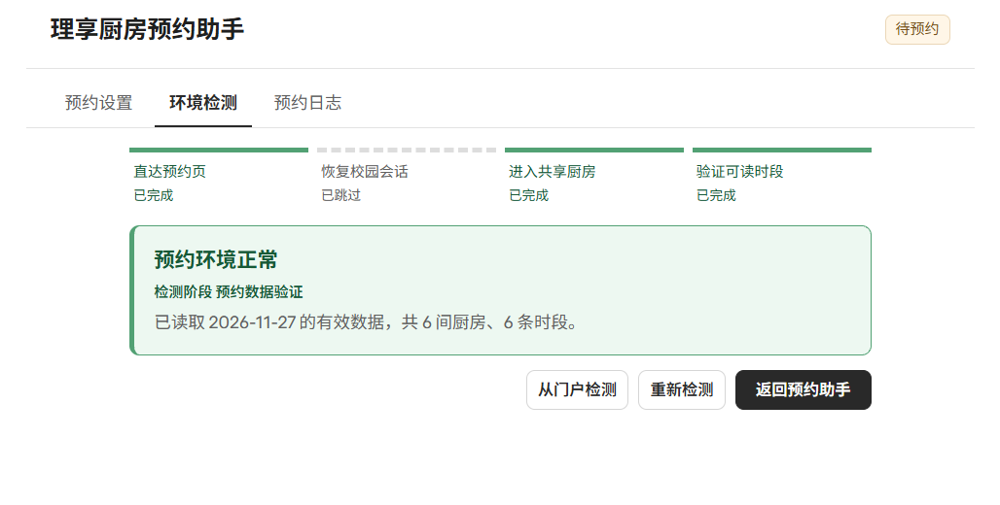
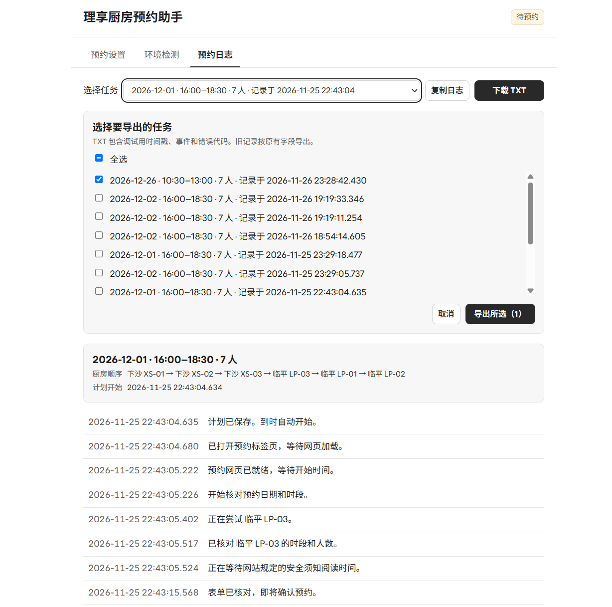

<div align="center">

# 理享厨房预约助手

### ZSTU Lixiang Kitchen Reservation

[](https://github.com/XuZihao-py/ZSTU-Lixiang-Kitchen-Reservation/releases/tag/v1.4.3)


[](./LICENSE)


**让校园厨房预约更加便捷。**

A better reservation experience for campus life.

[版本下载](https://github.com/XuZihao-py/ZSTU-Lixiang-Kitchen-Reservation/releases/latest) ·
[更新日志](./CHANGELOG.md) ·
[问题反馈](https://github.com/XuZihao-py/ZSTU-Lixiang-Kitchen-Reservation/issues) ·
[社区讨论](https://github.com/XuZihao-py/ZSTU-Lixiang-Kitchen-Reservation/discussions) ·
[隐私权政策](./PRIVACY.md) ·
[服务条款](./TERMS.md)

</div>

> [!WARNING]
> 本项目为独立开发的非官方浏览器扩展，仅供学习与技术研究使用。请遵守学校及官方预约平台的相关管理规定，合理使用校园公共资源。

## 关于项目 · About

理享厨房预约助手是一款面向浙江理工大学「理享食光 → 共享厨房」预约场景的 Chrome 浏览器扩展，旨在简化预约操作、减少重复操作并改善用户体验。

扩展支持预约计划管理、厨房优先顺序设置、预约环境检测、校园登录会话恢复、任务执行记录及预约结果反馈等功能。

自 v1.4.0 起，扩展采用统一预约工作台及全新透明背景图标，进一步改善浏览器工具栏和扩展页面的使用体验。

本项目复用用户在 Chrome 中已有的校园登录会话，预约配置及预约日志保存在用户设备本地。

本项目由开发者独立设计与维护，与浙江理工大学及其相关管理机构不存在官方隶属或授权关系。

## 主要功能 · Features

| 功能 | 说明 |
| --- | --- |
| 统一工作台 | 集中管理预约设置、环境检测及预约日志 |
| 工具栏快捷入口 | 快速查看预约摘要、检测结果及任务状态 |
| 预约配置 | 支持自定义预约日期、时段及人数 |
| 厨房选择 | 支持厨房选择及优先顺序设置 |
| 时间管理 | 基于北京时间管理预约任务 |
| 本地存储 | 在本机保存预约配置及任务状态 |
| 草稿恢复 | 在同一浏览器会话内恢复预约草稿 |
| 环境检测 | 显示检测结果和时间，支持预约前自动检查 |
| 会话恢复 | 通过数智浙理门户尝试恢复失效的预约登录会话 |
| 认证引导 | 在学校要求重新认证时提供页面跳转及操作提示 |
| 移动端兼容 | 在环境检测期间支持校园门户手机模式 |
| 诊断进度 | 分阶段展示环境检测过程及异常位置 |
| 信息校验 | 核对预约日期、厨房、时段、人数及表单状态 |
| 预约日志 | 查看最近 12 个预约任务的执行记录 |
| 运行提示 | 工具栏弹窗说明预约前的开机、联网及电源设置要求，支持关闭自动提示 |
| 日志导出 | 支持复制可读日志，以及按任务多选或全选下载 TXT 诊断日志 |
| 结果反馈 | 展示预约任务状态、执行结果及异常提示 |
| 电源管理 | 在预约任务执行期间请求系统保持唤醒 |

## 界面预览

### 预约设置工作台



### 工具栏弹窗



### 环境检测



### 预约日志与 TXT 导出



## 下载与安装 · Download & Installation

### 当前发布版本 · Current Release

[](https://github.com/XuZihao-py/ZSTU-Lixiang-Kitchen-Reservation/releases/tag/v1.4.3)

| 版本信息 | 内容 |
| --- | --- |
| 当前发布版本 | v1.4.3 |
| 扩展内部版本 | 1.4.3 |
| 发布类型 | 正式版 |
| 发布日期 | 2026-11-27 |
| 正式安装包 | [ZSTU-Lixiang-v1.4.3.zip](https://github.com/XuZihao-py/ZSTU-Lixiang-Kitchen-Reservation/releases/download/v1.4.3/ZSTU-Lixiang-v1.4.3.zip) |
| 扩展图标 | 透明背景图标 |

[查看版本发布说明](https://github.com/XuZihao-py/ZSTU-Lixiang-Kitchen-Reservation/releases/tag/v1.4.3) ·
[查看全部版本](https://github.com/XuZihao-py/ZSTU-Lixiang-Kitchen-Reservation/releases) ·
[完整更新日志](./CHANGELOG.md)

> [!NOTE]
> v1.4.3 修复月底翻页停留或跳月，以及 Chrome 自动翻译导致日历文字滞留的问题。跨月读取场次前会核对目标年月日。
>
> 正式安装包默认包含透明背景图标，无需额外下载图标资源或进行手动配置。
>
> 从旧版升级时，请更新原安装目录并在 Chrome 中重新加载扩展。

### 系统要求 · Requirements

| 项目 | 要求 |
| --- | --- |
| 浏览器 | Google Chrome 120 或更高版本 |
| 扩展规范 | Manifest V3 |
| 用户账号 | 合法有效的校园账号 |
| 网络环境 | 能够正常访问学校相关服务 |
| 设备状态 | 预约任务执行期间保持电脑开机及 Chrome 运行 |
| 浏览器权限 | 允许扩展使用实现相关功能所需的权限 |

### 安装步骤 · Installation

1. 进入 [GitHub Releases](https://github.com/XuZihao-py/ZSTU-Lixiang-Kitchen-Reservation/releases/latest)。
2. 在 Assets 中下载正式安装包 `ZSTU-Lixiang-v1.4.3.zip`。
3. 将压缩包解压至固定位置。
4. 在 Chrome 浏览器中打开 `chrome://extensions/`。
5. 开启右上角的「开发者模式」。
6. 点击「加载已解压的扩展程序」。
7. 选择解压目录中的 **extension** 文件夹。
8. 在 Chrome 的扩展程序菜单中固定「理享厨房预约助手」。

完成安装后，Chrome 工具栏将使用扩展自带的透明背景图标。

也可以通过 GitHub 仓库中的 **Code → Download ZIP** 获取 main 分支的当前源代码。

> [!NOTE]
> 正式安装包是面向普通用户提供的推荐安装方式。
>
> GitHub 自动生成的 Source code 压缩包为对应标签的源代码快照，main 分支可能包含尚未正式发布的开发内容。
>
> 建议普通用户统一使用 Assets 中的正式安装包。

## 使用指南 · User Guide

从 1.4.0 起，点击工具栏图标可查看预约摘要和检测状态。从 1.4.1 起，工具栏弹窗会显示运行提示，可选择以后不再提醒。

点击「打开工作台」可在一个标签页内切换预约设置、环境检测和预约日志。再次打开时会切回已有工作台。

### 1. 检测预约环境

工具栏弹窗和工作台都显示环境检测结果和检测时间。

| 颜色 | 环境检测状态 |
| --- | --- |
| 绿色 | 六小时内检测正常 |
| 红色 | 检测异常或等待认证 |
| 蓝色 | 正在检测 |
| 灰色 | 待检测 |
| 黄色 | 上次正常记录已超过 6 小时 |

打开工作台时，如果没有近期记录，扩展会尝试后台检测。

已有预约计划时，扩展会尝试在预约开始前 15 分钟检测一次。如果当时已有检测在运行，扩展会在准备窗口允许的情况下稍后重试。临近准备窗口或任务执行中会跳过自动检测。

后台检测发现登录失效时，可打开「环境检测」并选择「从门户检测」恢复校园会话。

扩展将检查预约网页的访问状态、登录会话及实际预约数据。

环境检测主要包括以下阶段：

1. 检查预约直达页。
2. 检查数智浙理门户及校园登录状态。
3. 检查理享食光与共享厨房入口。
4. 验证次日厨房及预约时段数据。

如果已有预约登录会话有效，部分门户检测步骤可能自动跳过。

检测过程中，页面将显示各阶段的完成状态及异常位置。

检测通过并保存结果后，点击「返回预约助手」即可回到同一工作台的预约设置，查看更新后的状态和检测时间。

当检测结果显示「预约环境正常」时，表示扩展已成功读取可核验的预约数据，但不代表目标日期或时段一定存在可用名额。

### 2. 恢复校园登录会话

如果预约登录会话失效，扩展会尝试通过数智浙理门户重新进入理享食光及共享厨房页面。

手动恢复时，检测用门户标签页会切到前台，以便服务中心加载。

当学校要求重新进行身份认证时，请点击检测页中的「前往统一认证」，并在学校官方页面完成相应操作。

如检测已结束，请在完成认证后返回检测页点击「重新检测」。

账号密码、验证码及扫码认证均由用户在学校官方页面自行完成。

扩展不会代替用户完成身份认证，也不会绕过学校设置的身份验证要求。

### 3. 移动设备模式

在通过校园门户恢复预约会话期间，扩展可能为检测相关的学校标签页临时启用手机模式。

手机模式用于设置页面的移动设备标识、屏幕尺寸及触控交互，以适配校园移动端门户。

环境检测和时段查询会在临时预约标签页启用 Chrome 的焦点模拟，让后台页面继续渲染和加载列表。Chrome 可能在这期间显示浏览器调试提示。

检测或查询结束时，扩展会解除临时页面的调试连接。

如需单独检查校园门户入口，可在环境检测页面选择「从门户检测」。

工作台中的「打开学校预约页」用于进入学校官网。已有登录会话时，也可以使用直达链接。

[共享厨房直达页](https://zhst.zstu.edu.cn/statusweb/h5/universityFrontOfficeProgram/#/featuredStalls/roomReserve/Index?spaceType=2&categoryCode=fixed&organizationId=0&pageId=2084927814681309185)

### 4. 配置预约任务

在左栏选择预约日期，等待中栏读取预约数据后选择时段。

在右栏设置预约人数并添加所需厨房，使用 ↑ 和 ↓ 调整厨房优先顺序。

尚未开放预约时，日历下方会显示预计最早开放预约时间。

已满时段也可能出现在列表中，实际可预约情况以官方页面为准。

在同一次 Chrome 会话内，关闭并重新打开工作台可以恢复预约草稿。

### 5. 确认预约授权

请先阅读学校官方预约平台的安全须知及相关管理规定。

确认预约配置无误后，在工作台的预约设置中勾选授权并点击「开始预约」。

请留意扩展显示的北京时间及建议开机区间。

### 6. 保持设备运行

在提示区间内保持电脑开机、网络连接正常，并确保 Chrome 保持运行。

扩展将打开专用预约标签页，并在任务执行期间请求系统保持唤醒。

请勿随意关闭预约任务所使用的标签页。

提前准备阶段如遇登录问题，请在学校官方页面完成登录，并根据实际情况重新检测或刷新预约页面。

### 7. 查看预约结果

工具栏弹窗和工作台右上角使用四种带颜色的任务状态：

- 待预约；
- 预约中；
- 预约成功；
- 预约失败。若自动流程结束时尚未收到明确结果，请按页面提示到学校预约页的「我的预约」核对。

具体结果可在工作台的预约详情或日志中查看。

当详细结果显示「待核对」时，请先到学校官方平台的「我的预约」核对实际结果。

如果学校要求补充信息、确认身份或完成付款，请通过官方页面人工处理。

> [!IMPORTANT]
> 扩展显示的任务状态及环境检测结果仅供参考。
>
> 实际预约结果以官方平台回执及「我的预约」中的记录为准。

### 8. 查看预约日志

在工作台点击「预约日志」即可查看执行记录。从 1.4.1 起，点击「下载 TXT」可勾选多个任务或全选，导出包含事件代码、时间戳和版本信息的诊断日志。

预约日志支持：

- 查看最近 12 个预约任务；
- 每个任务最多保留 60 条执行记录；
- 查看预约日期、时段、人数及厨房优先顺序；
- 查看任务执行时间及各阶段运行状态；
- 查看异常原因及人工处理提示；
- 复制预约日志；
- 下载 TXT 格式日志文件。

日志时间统一采用北京时间，并精确至毫秒。

预约日志保存在用户设备本地，不包含校园账号、联系人字段内容或登录凭据。

日志导出后，请妥善保管相关文件。

## 预约规则 · Reservation Rules

### 时间与提交

根据当前项目所依据的预约规则，预约窗口为北京时间每日 **07:30–23:00**，可预约次日起 1–6 天的日期。

扩展根据目标日期计算最早可约日，通常从 **07:25** 开始准备，**07:30** 开始执行，最晚工作至 **07:33**。

选择已开放预约的日期且当前仍处于预约窗口时，任务可以立即开始。

下一天仍在可预约范围内时，夜间设置的任务将等待下一个开放窗口。

扩展根据用户设定的厨房优先顺序检查可预约情况，并核对日期、厨房、时段、人数及表单状态。

扩展等待官方页面规定的安全须知阅读时间、滚动条件及按钮启用状态，不跳过网站要求的确认条件。

通过校验后，扩展按照任务授权进行单次预约提交。

如学校调整预约规则，以官方平台最新规定为准。

### 运行限制

- 时钟误差、设备休眠、网络环境及服务器负载可能影响预约。
- 校园登录会话可能在任务执行前失效。
- 环境检测正常不代表未来预约一定成功。
- 浏览器调试权限不可用或与开发者工具冲突时，临时预约页的后台渲染或移动设备模式可能无法启用。
- 学校门户或预约页面发生变化时，部分功能可能失效。
- 出现额外身份验证或付款要求时，需要用户人工处理。
- 本项目不保证预约成功，不提供额外预约资格。

## 浏览器权限 · Permissions

为实现相应功能，本项目使用以下 Chrome 扩展权限：

| 权限 | 用途 |
| --- | --- |
| Alarms | 安排预约任务的准备、启动及结束时间 |
| Storage | 保存预约配置、任务状态及预约日志 |
| Power | 在预约任务执行期间请求系统保持唤醒 |
| WebNavigation | 识别环境检测相关校园页面的导航及跳转 |
| Debugger | 为临时页面启用后台渲染、移动设备模式及触控模拟 |
| Host Permissions | 访问实现校园门户、统一认证及共享厨房功能所需的指定学校网站 |

当前版本声明的学校网站访问范围包括：

- `https://ie.zstu.edu.cn/*`
- `https://sso.zstu.edu.cn/*`
- `https://zhst.zstu.edu.cn/*`

本项目未申请访问所有网站的 Host Permissions。

Debugger 权限用于检测或查询时的后台渲染，以及校园门户的移动设备模式，不用于收集用户密码、浏览记录或其他无关个人信息。

有关信息处理及浏览器权限的详细说明，请参阅 [隐私权政策](./PRIVACY.md)。

## 更新与测试 · Updates & Testing

### 软件更新

建议通过 [GitHub Releases](https://github.com/XuZihao-py/ZSTU-Lixiang-Kitchen-Reservation/releases/latest) 获取最新正式安装包。

已安装旧版本的用户可以按照以下方式升级：

1. 确认当前没有正在执行的预约任务。
2. 下载并解压最新正式安装包。
3. 备份需要保留的旧版本文件及预约日志。
4. 使用新版 `extension` 目录中的内容替换原有安装目录。
5. 打开 `chrome://extensions/`。
6. 点击扩展对应的重新加载按钮。
7. 检查扩展权限及版本号，并重新进行环境检测。
8. 确认浏览器工具栏已显示新版透明背景图标。

> [!NOTE]
> v1.3.4 新增环境检测相关浏览器权限。从更早版本升级后，请留意 Chrome 的权限提示。
>
> 为尽可能保留原有本地数据，建议在原安装目录进行更新，避免不必要的卸载及重新安装。
>
> 本项目通过开发者模式安装，GitHub Release 的更新不会自动替换用户本地已安装的扩展。

### 版本编号 · Versioning

本项目采用 MAJOR.MINOR.PATCH 形式管理 Chrome 扩展版本，并通过 GitHub Release 标签区分正式版本及测试版本。

Chrome 扩展内部版本号以 `extension/manifest.json` 为准。

GitHub Release 中的 Beta、Beta 2 等后缀用于区分不同的公开测试发布。

仅涉及项目文档、视觉资源或发布内容的修订，可能沿用相同的扩展内部版本号。

同一版本发生发布修订时，以 GitHub Release 中提供的最新正式安装包为准，并在更新日志或发布说明中记录相关变更。

### 版本记录 · Version History

| 版本 | 发布类型 | 更新内容 |
| --- | --- | --- |
| [v1.4.3](https://github.com/XuZihao-py/ZSTU-Lixiang-Kitchen-Reservation/releases/tag/v1.4.3) | 正式版 | 修复月末翻页及 Chrome 自动翻译造成的跨月场次读取失败 |
| [v1.4.2](https://github.com/XuZihao-py/ZSTU-Lixiang-Kitchen-Reservation/releases/tag/v1.4.2) | 正式版 | 预约前检测重试、未确认结果显示及检测结果自动到期 |
| [v1.4.1](https://github.com/XuZihao-py/ZSTU-Lixiang-Kitchen-Reservation/releases/tag/v1.4.1) | 正式版 | 本地运行提示、按任务导出 TXT 诊断日志及界面截图 |
| [v1.4.0](https://github.com/XuZihao-py/ZSTU-Lixiang-Kitchen-Reservation/releases/tag/v1.4.0) | 正式版 | 统一工作台、透明背景图标、登录提示及四种预约状态 |
| [v1.3.8-beta](https://github.com/XuZihao-py/ZSTU-Lixiang-Kitchen-Reservation/releases/tag/v1.3.8-beta) | Beta | 修复后台环境检测和时段查询超时 |
| [v1.3.7-beta](https://github.com/XuZihao-py/ZSTU-Lixiang-Kitchen-Reservation/releases/tag/v1.3.7-beta) | Beta | 主页环境状态、自动检测、检测后返回和校园会话恢复改进 |
| [v1.3.4-beta.2](https://github.com/XuZihao-py/ZSTU-Lixiang-Kitchen-Reservation/releases/tag/v1.3.4-beta.2) | Beta | 完善项目文档、隐私权政策、服务条款及开发维护规范 |
| [v1.3.4-beta](https://github.com/XuZihao-py/ZSTU-Lixiang-Kitchen-Reservation/releases/tag/v1.3.4-beta) | Beta | 新增预约环境检测、校园登录会话恢复、移动设备模式及预约日志 |
| [v1.2.3-beta.2](https://github.com/XuZihao-py/ZSTU-Lixiang-Kitchen-Reservation/releases/tag/v1.2.3-beta.2) | Beta | 优化项目文档、安装指南及发布内容 |
| [v1.2.3-beta](https://github.com/XuZihao-py/ZSTU-Lixiang-Kitchen-Reservation/releases/tag/v1.2.3-beta) | Beta | 首次公开测试版本 |

完整版本记录请参阅 [CHANGELOG.md](./CHANGELOG.md) 或 [GitHub Releases](https://github.com/XuZihao-py/ZSTU-Lixiang-Kitchen-Reservation/releases)。

### 自动化测试 · Automated Tests

在项目根目录运行：

```bash
node tests/rules.cjs
node tests/booking-log.cjs
node tests/environment.cjs
node tests/environment-mobile.cjs
node tests/environment-entry.cjs
node tests/environment-status.cjs
```

相关测试用于验证预约规则、日志存储、环境识别、移动设备模式及校园门户入口等功能。

### 页面测试 · Page Tests

使用 Chrome 打开：

```text
tests/site-fixture.html
```

可以离线演练以下场景：

- 跨月选择预约日期；
- 顶栏日期与日历不一致；
- 表单日期不一致；
- 周中及周末预约时段；
- 预约容量已满；
- 安全须知条件；
- 提交锁及预约回执。

页面显示 `PASS` 表示对应测试通过。

测试通过不代表真实校园预约平台中的所有场景均可正常运行。

## 问题反馈 · Feedback

欢迎通过以下渠道提交问题、功能建议及使用体验。

| 渠道 | 用途 |
| --- | --- |
| [GitHub Issues](https://github.com/XuZihao-py/ZSTU-Lixiang-Kitchen-Reservation/issues) | 软件缺陷及功能建议 |
| [GitHub Discussions](https://github.com/XuZihao-py/ZSTU-Lixiang-Kitchen-Reservation/discussions) | 使用交流及社区讨论 |
| [GitHub Releases](https://github.com/XuZihao-py/ZSTU-Lixiang-Kitchen-Reservation/releases) | 版本发布及更新公告 |

提交问题时，建议提供：

- 扩展版本；
- Chrome 浏览器版本；
- 问题描述；
- 环境检测结果；
- 经过检查及脱敏的预约日志；
- 必要的界面截图。

> [!CAUTION]
> 请勿在公开反馈中提交校园账号、密码、验证码、Cookie、身份验证令牌、联系方式或其他敏感个人信息。

## 隐私权和条款 · Privacy & Terms

我们重视用户隐私、软件使用规范及知识产权保护。

| 文件 | 说明 |
| --- | --- |
| [服务条款（Terms of Service）](./TERMS.md) | 软件使用规范、用户责任及相关条款 |
| [隐私权政策（Privacy Policy）](./PRIVACY.md) | 信息处理、浏览器权限及隐私保护说明 |
| [软件许可说明（Software Licensing）](./LICENSE.md) | 面向中文用户的软件许可说明 |
| [软件许可证（License）](./LICENSE) | 正式软件授权文本 |
| [版权声明（Notice）](./NOTICE) | 知识产权及第三方资源声明 |

## 免责声明 · Disclaimer

本项目为独立开发的非官方浏览器扩展，仅供学习与技术研究使用，与浙江理工大学及其相关管理机构不存在官方隶属或授权关系。

本项目不提供预约资格，不保证预约成功，也不代表官方预约平台作出任何承诺。

使用本项目时，请遵守适用法律法规、学校管理规定及官方预约平台的相关规则，合理使用校园公共资源，尊重其他用户的合法权益。

## 软件许可 · License

本项目采用 **PolyForm Noncommercial License 1.0.0** 授权。

有关软件使用、修改、分发及非商业用途的具体规定，请参阅 [LICENSE](./LICENSE)。

第三方软件、字体及其他资源适用各自的许可证，详细信息请参阅 [NOTICE](./NOTICE)。

---

<div align="center">

**ZSTU Lixiang Kitchen Reservation**

Designed and developed by [Hsu Tzu-hao](https://github.com/XuZihao-py).

Copyright © 2026 Hsu Tzu-hao.

Licensed under the [PolyForm Noncommercial License 1.0.0](./LICENSE).

Independent development. For educational and research purposes.

[Terms of Service](./TERMS.md) ·
[Privacy Policy](./PRIVACY.md) ·
[Software Licensing](./LICENSE.md) ·
[License](./LICENSE) ·
[Notice](./NOTICE)

</div>
